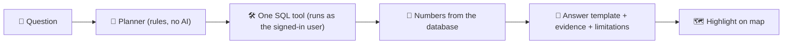

# 🤖 AI agent: "Investigate and Ask"

> **Status:** 🟨 Draft (2026-10-17). Source: `src/lib/agent.ts`, `src/components/InvestigatePanel.tsx`, the SQL tools in `supabase/migrations/`.
> 🔐 What each role may see: [roles-and-permissions.md](roles-and-permissions.md). Tables: [data-model.md](data-model.md).

## 🎯 What it is
A question box. An operator asks about the incidents they are allowed to see; the agent answers with numbers, a small chart, the evidence behind them, and its limitations, and rings the relevant incidents on the map. **The agent recommends. The human decides.**

## ⚙️ How it works today (mock mode)

- 🧭 The **planner** picks one tool from the question's words. Today it is plain rules in code.
- 🛠️ The **tools** are database functions that run **as the user**, so row-level security applies. The agent can never return rows the user cannot see.
- 🔢 **All numbers come from SQL.** Text is a template filled with those numbers. Nothing is invented.
- 🏷️ The panel shows a **Mock mode** badge so nobody thinks an LLM wrote it.

## 🗂️ Categories
Say "illegal dumping" or "parking" in the question to limit it to that category. With no category named (or both), the agent uses **all categories you may see** and says so in every answer ("Category: ..."). Specialists only ever get their assigned categories.

## 🔎 The five investigations
| | Question type | Tool (SQL function) | Notes |
|---|---|---|---|
| ✅ A | Which localities have the most incidents? | `tool_incidents_by_locality` | Ties are reported, not hidden |
| ✅ B | When do incidents happen (in a locality)? | `tool_time_distribution` | Bogotá time, 4-hour blocks, busiest weekday |
| ✅ C | Which locations have repeated reports? | `tool_recurring_locations` | **Exact** (same described place) vs **approximate** (~200 m); never claims "same event" |
| ✅ D | Have incidents increased over the last N days? | `tool_period_comparison` | Default 30 days; no percentage if the previous period is empty; flags small samples and incomplete periods |
| ✅ E | Which area deserves a look tomorrow evening? | `tool_candidate_areas` | Ranks by 16:00 to 20:00 incidents over 90 days; produces a **proposal for human review** |

Unsupported questions get an honest "I cannot answer that yet". The agent does not guess.

## 📦 What every answer contains
`text` · `bars` (small chart) · `evidence` (tool, scope, period, incident count, example references) · `limitations` (always) · `highlightIds` (incidents ringed on the map) · optional `proposal` (a recommendation draft, investigation E only).

## 🛡️ Rules (never break these)
1. 🔢 Never invent a statistic. Numbers, comparisons, percentages and counts are **calculated by SQL or deterministic code**, not by a language model.
2. 📎 Always show the evidence and the limitations. Always say the data is synthetic.
3. 🚫 Never claim a legal violation. The agent identifies *potential obstruction problems*.
4. 📷 Never claim to have inspected photos or video: media are placeholders today.
5. 🧑 Never act. Sending a proposal for review creates a *proposed* recommendation; a person approves or rejects it.
6. ❓ If the data cannot support an answer, say so.

## 🔮 Target and done
| | Item |
|---|---|
| ⬜ | An **Edge Function** replaces the rule-based planner with an LLM that picks tools. The tools, the answer shape and the rules above stay the same; the API key stays on the server. |
| 🟩 | Done: tools respect role, locality and **category scope**, need the `ask_agent` permission, and accept a category. |
| ⬜ | The agent **advises escalation** instead of direct approval for large interventions (for example grouped reports in one area). |
| 🟩 | Done: illegal dumping works with every investigation. Later categories need only a new row in `incident_categories`. |
| ⬜ | "Why are you recommending this?" follow-up that explains from the stored evidence. |

## 🟥 Known gaps
- The planner understands a limited set of phrasings (the six suggested questions and close variants).
- It cannot yet follow up on a previous answer.
