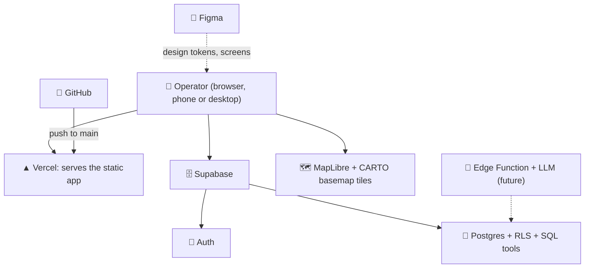

# 🏗️ Architecture

> **Status:** 🟨 Draft (2026-10-17).

## 🗺️ The big picture

- The app is **static**: nothing runs on Vercel except the build. The browser talks to Supabase directly with the user's own sign-in token.
- 🔐 **The database is the security boundary** (row-level security). The screen is never trusted to enforce access.

## 🧱 Stack
| Layer | Choice |
|---|---|
| Frontend | React 19, TypeScript (strict), Vite, Tailwind v4, shadcn/ui (Radix) |
| Map | MapLibre GL, dark CARTO basemap (OpenStreetMap data, no key) |
| Backend | Supabase: Auth, Postgres, RLS, SQL functions |
| Hosting | Vercel (auto-deploys every push to `main`) |
| Tests | Vitest (unit), SQL smoke test (permissions) |
| Language of the UI | English; dark theme only |

## 🌍 Environments
| | Where | Notes |
|---|---|---|
| 💻 Local | `npm run dev` (port 5173, or the next free one) | Reads `.env.local` (never committed) |
| 🚀 Production | https://civic-pulse-oct-8.vercel.app | Environment variables set in Vercel, see [deploy.md](deploy.md) |
| 🗄️ Database | One Supabase project shared by local and production | ⚠️ Local testing writes to the same data as production |

## 📁 Where things are
| Path | What |
|---|---|
| `src/components/` | Screens: dashboard, map, Investigate panel, Recommendations, sign-in |
| `src/lib/agent.ts` | Rule-based planner and answer templates ([ai-agent.md](ai-agent.md)) |
| `src/lib/auth.tsx`, `src/components/AuthGate.tsx` | Sign-in state and access gate |
| `supabase/migrations/` | Database, in order ([data-model.md](data-model.md)) |
| `supabase/seed/`, `supabase/tests/` | Synthetic data; permission smoke test |
| `docs/` | You are here |

## 🔄 One request, end to end
1. Operator signs in; Supabase returns a token that identifies them.
2. The app asks Supabase for incidents; Postgres adds a filter from the user's role and scope ([roles-and-permissions.md](roles-and-permissions.md)).
3. Operator asks the agent a question; the app calls one SQL tool **with the same token**, so the same filter applies.
4. Proposing or deciding writes rows; triggers write the audit trail.

## ⚠️ Constraints worth remembering
- 🧊 **Map needs WebGL2.** Without hardware acceleration the app shows a list instead (no blank screen).
- 🔤 **Fonts:** Gilroy is licensed and committed in the repo ([decisions/0006](decisions/0006-gilroy-fonts-in-repo.md)).
- 📵 No real incident data, photos or personal data: everything is synthetic.
