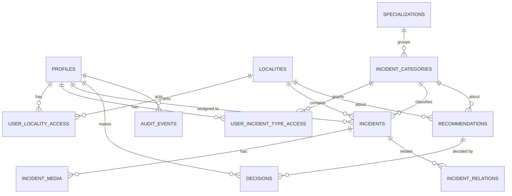

# 🗃️ Data model

> **Status:** 🟩 Up to date with the database (2026-10-17). Source: `supabase/migrations/*.sql`. The database is the truth; this page explains it.
> 🔐 Who may read or write each table is defined in [roles-and-permissions.md](roles-and-permissions.md).

## 🗺️ How the tables relate

`role_permissions` stands alone: it lists which actions each role may do.

## 📋 Tables (13)
| Table | Purpose | Key points |
|---|---|---|
| 🏙️ `localities` | The 20 official Bogotá localities | `code` 1 to 20. Boundaries not loaded yet (markers only). |
| 👤 `profiles` | One row per user, created automatically at sign-up | `role` is **null** until a Super Admin assigns one. `is_active`. `email` copied from sign-up (the browser cannot read the auth table). A trigger blocks demoting or switching off the last active Super Admin. |
| 📍 `user_locality_access` | Which localities a user may see | (user, locality). |
| 🏷️ `user_incident_type_access` | Which categories a **specialist** may see | (user, category). Locality Admins and Super Admins do not need rows. |
| 🧩 `specializations` | Groups of categories | `traffic`, `environmental`, `infrastructure`. |
| 🗂️ `incident_categories` | What kind of incident | `parking` (traffic), `illegal_dumping` (environmental). Infrastructure has none yet. `active` flag. |
| 🔐 `role_permissions` | **What each role may do**, as data | (role, action). Read by the app and by every access rule. 28 rows. |
| 🚨 `incidents` | Reports (all **synthetic**) | See columns below. 650 today: 500 parking, 150 illegal dumping. |
| 🔗 `incident_relations` | Duplicate or related reports | `duplicate`, `possibly_related`, `same_location`. |
| 📷 `incident_media` | Photos and videos per incident | `storage_path` empty while placeholder. Files go to a private Storage bucket later. |
| 💡 `recommendations` | Suggestions for human review | Has `category`. `evidence` (counts and incident ids from SQL), `limitations`, `status`. |
| ✔️ `decisions` | Approve or reject, **append-only** | Who, when, explanation. A trigger updates the recommendation status. |
| 📜 `audit_events` | Who did what | Written **only by triggers or the escalation function**; users cannot forge entries. User management logs `user_role_changed`, `user_activation_changed`, `locality_access_granted/revoked`, `category_access_granted/revoked`. |

### 🚨 `incidents` columns, grouped
- **Identity:** `id`, `reference` (CP-00001 parking, CD-00001 dumping), `title`, `description`, `category`.
- **Where and when:** `locality_code`, `lat`, `lng` (inside Bogotá bounds), `location_description`, `occurred_at`, `reported_at` (never before occurred).
- **What:** `vehicle_type`, `license_plate` (fictional or empty), and the **type**: `obstruction_subtype` for parking, `subtype` for other categories (household waste, construction debris, bulky items). A rule requires `obstruction_subtype` when the category is parking.
- **AI vs human:** `ai_classification`, `ai_confidence` (0 to 1), `uncertainty_flags`, then `validation_status` and `status` (see [incident-lifecycle.md](incident-lifecycle.md)).
- **Work:** `assigned_to` (exists, no screen yet), `outcome`.
- **Honesty flag:** `is_synthetic` (always true today). `evidence_metadata` is placeholder data.

## 🔤 Enums
`app_role` (**3**: super_admin, locality_admin, specialist_operator) · `incident_status` (9) · `obstruction_subtype` (6) · `vehicle_type` (6) · `recommendation_status` (**4**: proposed, needs_second_approval, approved, rejected) · `media_kind` (photo, video).

## ⚙️ Database functions
| Kind | Names | Security |
|---|---|---|
| 🔑 Permission helpers | `current_app_role`, `has_permission(action)`, `can_access_locality`, `can_access_category`, `can_access(locality, category)`, `shares_locality_with(user)` | Run as the database; callable only by signed-in users. Used by every access rule. |
| ⬆️ Escalation | `escalate_recommendation(id, note)` | Checks permission and scope; sets `needs_second_approval`; writes an audit event. No screen yet. |
| 🪝 Triggers | `handle_new_user`, `guard_profile_changes`, `apply_decision`, `audit_recommendation_proposed` | Not callable from the API. |
| 🛠️ Agent tools | `tool_incidents_by_locality`, `tool_time_distribution`, `tool_period_comparison`, `tool_recurring_locations`, `tool_candidate_areas` | Run **as the signed-in user** (RLS applies), need the `ask_agent` permission, take an optional category. See [ai-agent.md](ai-agent.md). |

## 🌱 Seed data
- `supabase/seed/synthetic_incidents.sql`: 500 **parking** incidents over 120 days across 19 localities (Sumapaz has none: it lies south of the allowed latitude), recurring hotspots, a Chapinero spike in the last 30 days.
- `supabase/seed/synthetic_illegal_dumping.sql`: 150 **illegal dumping** incidents, concentrated in the south (Ciudad Bolívar, Usme, Bosa, Kennedy, Tunjuelito), mostly at night, with recurring hotspots.
- Both include placeholder media rows and are re-runnable; each deletes only its own category.

## 📦 Migrations (run in this order)
1. `20261014000000_init_civic_pulse.sql`: tables, roles, RLS, triggers.
2. `20261014010000_investigation_tools.sql`: ranking, time and period tools.
3. `20261014020000_recurring_and_recommendations.sql`: recurring places, candidate areas, audit hardening.
4. `20261014030000_incident_media.sql`: photos and videos.
5. `20261017000000_escalation_status.sql`: the `needs_second_approval` status.
6. `20261017010000_roles_alignment.sql`: 3 roles, specializations and categories, permissions as data, category scoping, escalation function, category-aware tools.

## 🎯 Still to build
| | Item |
|---|---|
| ⬜ | Screens to manage users, roles, localities and categories (Super Admin). |
| ⬜ | Team view and incident assignment screens (Locality Admin). |
| ⬜ | Escalate button (the database function exists). |
| ⬜ | Infrastructure categories, once defined. |
