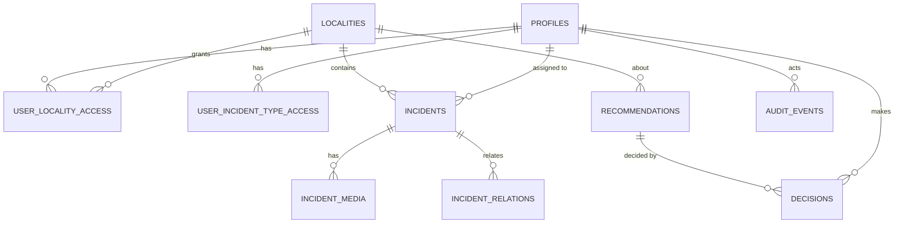

# 🗃️ Data model

> **Status:** 🟨 Draft (2026-10-17). Source: `supabase/migrations/*.sql`. The database is the truth; this page explains it.
> 🔐 Who may read or write each table is defined in [roles-and-permissions.md](roles-and-permissions.md).

## 🗺️ How the tables relate

## 📋 Tables (as built, 10)
| Table | Purpose | Key points |
|---|---|---|
| 🏙️ `localities` | The 20 official Bogotá localities | `code` 1 to 20, `name`. Boundaries not loaded yet (markers only). |
| 👤 `profiles` | One row per user, created automatically at sign-up | `role` is **null** until a Super Admin assigns one. `is_active`. |
| 📍 `user_locality_access` | Which localities a user may see | (user, locality). |
| 🏷️ `user_incident_type_access` | Which categories a user may see | (user, category). Category is only `parking` today. |
| 🚨 `incidents` | Parking-obstruction reports (all **synthetic**) | See columns below. |
| 🔗 `incident_relations` | Duplicate or related reports | `duplicate`, `possibly_related`, `same_location`. |
| 📷 `incident_media` | Photos and videos per incident | `storage_path` empty while placeholder. Files go to a private Storage bucket later. |
| 💡 `recommendations` | Suggestions for human review | `evidence` (counts and incident ids from SQL), `limitations`, `status`. |
| ✔️ `decisions` | Approve or reject, **append-only** | Who, when, explanation. A trigger updates the recommendation status. |
| 📜 `audit_events` | Who did what | Written **only by triggers**; users cannot forge entries. |

### 🚨 `incidents` columns, grouped
- **Identity:** `id`, `reference` (CP-00001), `title`, `description`, `category`.
- **Where and when:** `locality_code`, `lat`, `lng` (inside Bogotá bounds), `location_description`, `occurred_at`, `reported_at` (never before occurred).
- **What:** `vehicle_type`, `license_plate` (fictional, never a real format), `obstruction_subtype`.
- **AI vs human:** `ai_classification`, `ai_confidence` (0 to 1), `uncertainty_flags`, then `validation_status` (`pending`, `human_validated`, `human_rejected`) and `status` (see [incident-lifecycle.md](incident-lifecycle.md)).
- **Work:** `assigned_to` (exists, not used yet), `outcome`.
- **Honesty flag:** `is_synthetic` (always true today). `evidence_metadata` is placeholder data.

## 🔤 Enums
`app_role` (5 values, to become 3) · `incident_status` (9) · `obstruction_subtype` (6) · `vehicle_type` (6) · `recommendation_status` (3) · `media_kind` (photo, video).

## ⚙️ Database functions
| Kind | Names | Security |
|---|---|---|
| 🔑 Permission helpers | `current_app_role`, `can_access_locality`, `can_access_category`, `can_decide` | Run as the database; callable only by signed-in users. Used by RLS. |
| 🪝 Triggers | `handle_new_user` (creates profile), `guard_profile_changes` (nobody edits own role), `apply_decision`, `audit_recommendation_proposed` | Not callable from the API. |
| 🛠️ Agent tools | `tool_incidents_by_locality`, `tool_time_distribution`, `tool_period_comparison`, `tool_recurring_locations`, `tool_candidate_areas` | Run **as the signed-in user**, so RLS applies. See [ai-agent.md](ai-agent.md). |

## 🌱 Seed data
`supabase/seed/synthetic_incidents.sql`: 500 incidents over the last 120 days across 19 localities (Sumapaz has none: it lies south of the allowed latitude), recurring hotspots, a Chapinero spike in the last 30 days, 1,114 placeholder media rows. Re-runnable.

## 📦 Migrations (run in this order)
1. `20261014000000_init_civic_pulse.sql`: tables, roles, RLS, triggers.
2. `20261014010000_investigation_tools.sql`: ranking, time and period tools.
3. `20261014020000_recurring_and_recommendations.sql`: recurring places, candidate areas, audit hardening.
4. `20261014030000_incident_media.sql`: photos and videos.

## 🎯 Target changes (from the roles spec, not built)
| | Change |
|---|---|
| ⬜ | Reduce `app_role` to 3 values (recreate the type). |
| ⬜ | New `specializations` and `incident_categories` tables (traffic, environmental, infrastructure); category check removed from `incidents`. |
| ⬜ | `user_incident_type_access` points at categories. |
| ⬜ | `role_permissions` table plus `has_permission(action)`, used by RLS. |
| ⬜ | `needs_second_approval` recommendation status; recommendations and decisions scoped by category. |
| ⬜ | Synthetic illegal-dumping incidents. |
