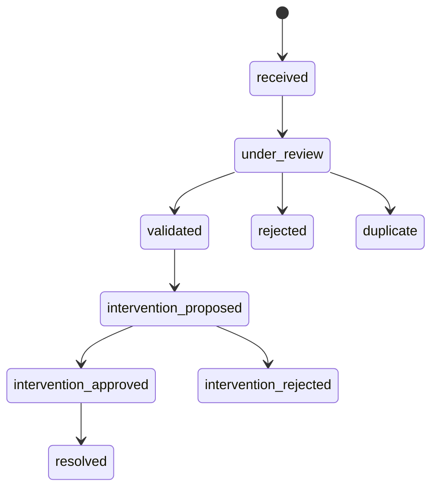
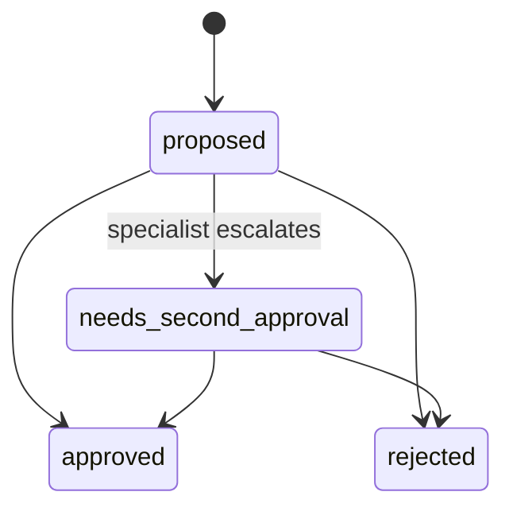
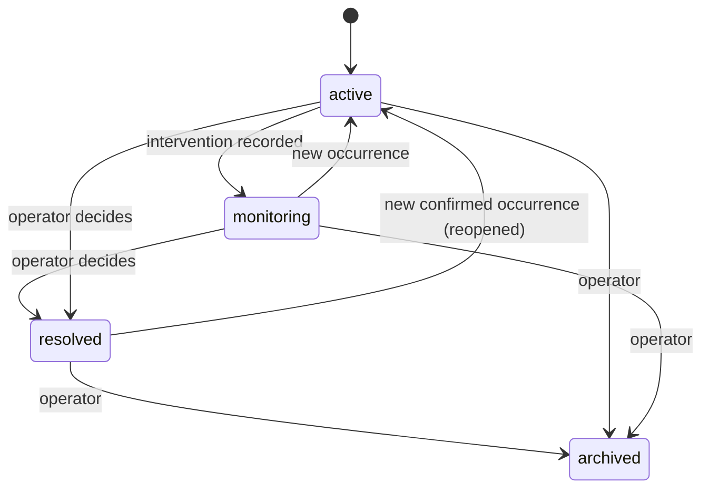

# 🔄 Incident & recommendation lifecycle

> **Status:** 🟨 Draft (2026-10-17). Source: the original brief (section 11), `incident_status` and `recommendation_status` in the database.
> 🔐 Who may move something between states: see [roles-and-permissions.md](roles-and-permissions.md).

## 🤖 vs 🧑 The most important rule
- 🤖 The AI may **classify**, estimate **confidence**, flag **uncertainty** and suggest **related incidents** (`ai_classification`, `ai_confidence`, `uncertainty_flags`).
- 🧑 A **human** validates (`validation_status`) and makes every consequential decision.
- The two are stored separately so you can always tell what the machine said from what a person decided.

## 🚨 Incident status (9 values)

| Status | Meaning |
|---|---|
| `received` | Reported, nobody has looked yet |
| `under_review` | A person is checking it |
| `validated` | Confirmed as a real obstruction |
| `rejected` | Not valid |
| `duplicate` | Same as another report (see `incident_relations`) |
| `intervention_proposed` / `approved` / `rejected` | A recommendation about it was proposed, approved or rejected |
| `resolved` | Closed |

**What people see (map dots and counts):** four statuses, grouped from the states above. **Pending** = `received`; **Reviewing** = `under_review`; **Approved** = `validated`, `intervention_proposed`, `intervention_approved`, `resolved`; **Rejected** = `rejected`, `duplicate`, `intervention_rejected`. The database keeps all nine; only labels and colors are grouped (`groupOf` in `src/lib/incidents.ts`, test in `incidents.test.ts`). "Community validation" is not a status: finding patterns is the agent's job ([ai-agent.md](ai-agent.md)).

> 🔶 These are the **intended** transitions. The database lists the values but does **not** enforce the order yet.

## 💡 Recommendation status
> 🖥️ **The recommendation screens were removed on 2026-10-18** ([decision 0009](decisions/0009-recommendations-screens-removed.md)). The database, rules and tests below are kept and still work; there is just no screen for them now.

- ✅ **As built:** `proposed`, `needs_second_approval`, `approved`, `rejected`. A recommendation always starts as `proposed`. It changes only through a recorded **decision** (a trigger updates the status and writes the audit event) or through **escalation** (`escalate_recommendation`, specialists only, writes an audit event).
- 🔒 Once escalated (`needs_second_approval`), only a Locality Admin or Super Admin can decide it. A specialist cannot.
- ⬜ **No screen yet** for escalation; the database function works and is tested.
- 🛑 **Approval never triggers a real-world action.** No ticketing, dispatch or enforcement.

## 🧭 Problem status (4 values)
> 🟨 *Target, decision [0030](decisions/0030-problems-above-incidents.md); not built yet.* A problem has its **own** lifecycle, independent of its incidents'. The incident statuses above and their four map colors do not change.

| Status | Meaning |
|---|---|
| `active` | The problem exists or has an unresolved occurrence |
| `monitoring` | An intervention took place and the place is being watched |
| `resolved` | Enough evidence that the underlying problem is solved (set by a person) |
| `archived` | No longer actively managed, or administratively dropped |

**Rules that always hold**
1. A confirmed new occurrence on a `resolved` problem reopens it to `active` and writes a `reopened` event. Earlier incidents, interventions and the resolution history stay.
2. **No new reports never set a problem to `resolved`.** The view only shows a derived "quiet" label.
3. Closing, rejecting or marking an incident duplicate never changes its problem.
4. **Recurrence is a metric** (`occurrences − 1`), not a status. It counts occurrences, never reports.
5. **Report vs occurrence:** many reports of the same event (for example five citizens, one parked car, the same pile of waste) are **one occurrence**. A new occurrence needs evidence: a documented intervention (cleared or partial) between the two, a different vehicle or object, or an explicit sign it is a different pile. A gap of more than 24 hours is only a signal to check; if the evidence is not enough the boundary is marked **uncertain** and the report waits for review instead of inventing a new event.
6. The problem's own map colors are separate from the incident colors.

## 🟥 Gaps (as built)
| | Gap |
|---|---|
| 🟥 | The app has **no screen to change an incident's status**. Statuses are set by the seed only. |
| 🟥 | Approving a recommendation does **not** change the status of its incidents. A recommendation is about a *place*, linked to incidents only through its evidence list. |
| 🟥 | Transition order is not enforced by the database. |

## ❓ Open questions
1. 🔶 When a recommendation is approved, should its incidents move to `intervention_approved` automatically?
2. 🔶 After `intervention_rejected`, does the incident go back to `validated`?
3. 🔶 Who may change an incident's status (follow the matrix: Super Admin and Locality Admin, or also specialists in their categories)?
