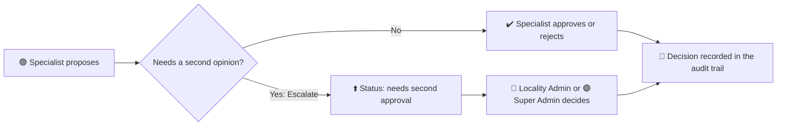

# 🔐 Civic Pulse: Roles & Permissions Spec

> 📚 Part of the [documentation index](README.md).

> **Status:** ✅ Approved by the owner (2026-10-17). This file is the **single source of truth**: change it first, then the code, then the tests.
> ⚠️ The code is **not yet aligned** with this spec (see section 9).

## ⚡ In 30 seconds
- 🟣 **Super Admin**: runs the whole city and the system.
- 🔵 **Locality (Zone) Admin**: manages incidents and coordinates the team in their zone.
- 🟢 **Specialist Operator**: investigates one kind of incident (traffic, environmental or infrastructure) in their zone, and escalates when needed.
- 🔒 Everyone starts with **no access**. Rules are enforced in the **database**, not by hiding buttons.

## 🗝️ Legend
| Symbol | Meaning | | Symbol | Meaning |
|---|---|---|---|---|
| 🟣 | Super Admin | | ✅ | Allowed |
| 🔵 | Locality (Zone) Admin | | ❌ | Not allowed |
| 🟢 | Specialist Operator | | 🔶 | Allowed, but only inside the user's scope |
| 🚦 | Traffic | | 🟩 | Active / working |
| 🌿 | Environmental | | 🟨 | Partly done |
| 🏗️ | Infrastructure | | 🟥 | Gap or problem to fix |
| ⚪ | Created but empty / inactive | | ⬜ | To do |

---

## 🎯 1. Principles
1. 🔒 **Least privilege.** A new user has no role and sees nothing until a Super Admin assigns one.
2. 🛡️ **Enforced in the database**, never only in the screen. The UI may hide things for clarity; the database must still refuse.
3. 🧭 **Four things decide what a user can do:** their **role**, their **localities**, their **incident categories**, and the **actions** allowed (section 4).
4. 🤖 **The AI agent has no extra power.** It works as the signed-in user, so it can never show what that user could not see.
5. 📜 **Everything important is recorded** in an audit trail that users cannot forge.

---

## 👥 2. Roles (3 active)
| | Role | Where they work | What they are for |
|---|---|---|---|
| 🟣 | **Super Admin** | Whole city, all categories | Full access across the city. Manages users, roles and system settings. |
| 🔵 | **Locality (Zone) Admin** | Their localities, **every category** inside them | Manages incidents and coordinates their team within their zone. |
| 🟢 | **Specialist Operator** | Their localities, **only the categories the Super Admin gives them** | Investigates incidents in their categories and escalates when needed. |

> 🗑️ **Removed on 2026-10-17:** General Operator and Sector Admin. If sector-level access is ever needed, it comes back as a new *geographic scope*, not as a role.

### 🧩 Specialist Operator and specializations
A **specialization** is a *group of incident categories*. The Super Admin picks the **categories for each person**; the specialization is just the label that follows. All specialists have **identical permissions**: they differ only in categories.

| | Specialization | Incident categories under it | Status |
|---|---|---|---|
| 🚦 | **Traffic** | Obstructive parking | 🟩 Active, has data |
| 🌿 | **Environmental** | Illegal dumping | 🟨 Active; synthetic data still to be created |
| 🏗️ | **Infrastructure** | *(none yet)* | ⚪ Created, empty. Categories added later |

---

## 🗺️ 3. Scope (where and what a user can see)
- 📍 **Geography:** the 20 official Bogotá localities. 🟣 sees all; 🔵 and 🟢 only their assigned localities.
- 🏷️ **Categories:** 🟣 all. 🔵 all categories inside their localities. 🟢 only the categories assigned to them.
- 🚫 A specialist with **no categories** sees **nothing** (least privilege).
- 🗺️ The map may show Bogotá as background, but never restricted records.

---

## 🔐 4. Permission matrix
✅ allowed · ❌ not allowed · 🔶 allowed inside the user's scope

| Action | 🟣 Super Admin | 🔵 Locality (Zone) Admin | 🟢 Specialist Operator |
|---|---|---|---|
| 👁️ View incidents | ✅ all | 🔶 their localities, all categories | 🔶 their localities and categories |
| 📷 View evidence (photos, videos) | ✅ all | 🔶 in scope | 🔶 in scope |
| 💬 Ask the AI agent | ✅ all data | 🔶 in scope only | 🔶 in scope only |
| 📝 Propose a recommendation | ✅ | ✅ | ✅ |
| ✔️ Approve / reject a recommendation | ✅ | ✅ | 🔶 their categories and localities |
| ⬆️ Escalate for a second approval | n/a | n/a (they are the ones who receive it) | ✅ their choice |
| 🧑‍⚖️ Review escalated recommendations | ✅ | ✅ | ❌ |
| 📌 Assign incidents to a team member | ✅ | 🔶 within their zone | ❌ |
| 👨‍👩‍👧 View their team | ✅ all | 🔶 their zone | ❌ |
| 📜 View audit trail | ✅ all users | 🔶 own actions | 🔶 own actions |
| 🧑‍💼 Manage users, roles, localities and categories per person | ✅ | ❌ | ❌ |
| ⚙️ Manage system settings (specializations, categories, which localities exist) | ✅ | ❌ | ❌ |

### ⬆️ Escalation rule

- 🧠 Escalation is the **specialist's choice** for now.
- 🔮 **In the future** the AI agent will *advise*: "I recommend you escalate instead of approving", for example when several reports in the same area should be grouped into one big intervention.
- 🔒 Once escalated, a **specialist can no longer decide** it. Only 🔵 or 🟣.
- 🖥️ No screens are specified here. They come later, with the agent.

---

## 🚪 5. How users get access (provisioning)
1. 🆕 Anyone can register. They get **no role** and see an "Access pending" screen.
2. 🟣 **Only a Super Admin** assigns role, localities and categories. Nobody can change their own.
3. 🥇 The **first Super Admin** is set once by SQL in the Supabase SQL editor (README, section "Auth and roles"), never from the app.
4. 🚀 Before going live: "Confirm email" on and leaked-password protection on ([deploy.md](deploy.md)).

---

## 🛡️ 6. Rules that must always hold
1. 🚫 Nobody can give themselves a role, activation, or a wider scope.
2. 🔍 Nobody receives records outside their localities and categories: not through the screen, the API or the AI agent.
3. 📝 A recommendation starts as *proposed*. Its status changes only through a recorded decision or escalation.
4. 🧾 Decisions are append-only. Audit events are written only by the database and cannot be forged.
5. ⚙️ Only a Super Admin changes system settings and access.
6. 🔒 A recommendation waiting for a second approval cannot be decided by a Specialist.

---

## 🧪 7. Test cases (they map to `supabase/tests/rls_smoke.sql`)
| # | Case | Expected | Covered today |
|---|---|---|---|
| T1 | 🔵 reads incidents | only their localities, all categories | ✅ |
| T2 | 🟢 reads incidents | only assigned localities and categories | ⬜ |
| T3 | 🟢 with no categories | sees nothing | ⬜ |
| T4 | Anyone but 🟣 changes their own role | blocked | ✅ |
| T5 | 🟢 proposes outside their scope | blocked | ⬜ |
| T6 | 🟢 approves inside their scope | allowed | ⬜ |
| T7 | 🟢 decides an escalated recommendation | blocked | ⬜ |
| T8 | 🔵 decides an escalated recommendation | allowed | ⬜ |
| T9 | 🔵 creates or changes a user | blocked | ⬜ |
| T10 | 🔵 reads another locality | blocked | ✅ |
| T11 | Agent tools run as a restricted user | scoped like T1 or T2 | ✅ |
| T12 | Anyone inserts an audit event or a pre-approved recommendation | blocked | ✅ |

---

## ❓ 8. Open questions
1. 🔶 Should escalation ever be **mandatory** (for example for grouped incidents)? *Today: advisory, agent-suggested later.*
2. 🔶 May a 🔵 approve a recommendation **they proposed themselves**? *Suggestion: yes for the MVP, always audited.*
3. 🔶 What does "view their team" show: name and specialty only, or also open work? *Suggestion: name, specialties, number of open assigned incidents.*
4. 🔶 If a specialist belongs to several localities, can the 🔵 of just one of them see them? *Suggestion: yes, inside the shared locality.*

---

## 🧱 9. As built today (2026-10-17) and gaps
| | Item |
|---|---|
| 🟥 | Database has **5** roles including the two removed ones. Locality Admin, Specialist and General Operator behave **identically**. Only Super Admin differs. |
| 🟥 | Category is hard-coded to `parking`. No specializations or categories tables. |
| 🟥 | A Locality Admin currently needs category rows like a specialist. They should see all categories in their localities. |
| 🟥 | Recommendations and decisions are filtered by **locality only**, not category: a specialist could see other categories' recommendations. |
| 🟥 | No escalation status, no team view, no assignment screen (`incidents.assigned_to` exists but is unused). |
| 🟥 | No screen to assign roles or scope (SQL only). Frontend repeats the role list (`DECIDERS` in `src/components/RecommendationsPanel.tsx`). |
| 🟨 | `rls_smoke.sql` covers only some cases (see section 7). |
| 🟩 | Working: least-privilege default, scope by locality, audit written by triggers, agent tools scoped to the user, first-admin bootstrap. |

---

## 🛠️ 10. Implementation notes (not built; separate approval)
- 🧱 Reduce `app_role` to 3 values (Postgres cannot drop enum values, so the type is recreated and data migrated).
- 🗃️ New tables: `specializations`, `incident_categories` (code, name, specialization, active). `user_incident_type_access` points at categories.
- 📋 Store this matrix as data (`role_permissions`) with a `has_permission(action)` function that RLS policies call. One TypeScript `can(role, action)` mirrors it for the screens.
- ⬆️ Add `needs_second_approval` to the recommendation statuses; scope recommendations and decisions by category.
- 🖥️ Super Admin screen (users, roles, localities, categories); one sample user per role; tests T1 to T12; synthetic illegal-dumping incidents.

---

## 📜 11. Decision log
| Date | Decision | Why |
|---|---|---|
| 2026-10-17 | Roles reduced to 🟣 Super Admin, 🔵 Locality (Zone) Admin, 🟢 Specialist Operator | Simpler, matches the real organization |
| 2026-10-17 | Specialists differ only by categories, assigned per person by the Super Admin | Same duties, different incident types |
| 2026-10-17 | 🚦 Parking under Traffic; 🌿 illegal dumping under Environmental; 🏗️ Infrastructure created empty | Owner's category model |
| 2026-10-17 | 🔵 sees all categories in their localities | Brief: investigate incidents within authorized localities |
| 2026-10-17 | Specialists approve within scope and can escalate for a second approval | Owner's escalation model (replaces the earlier "only admins approve") |
| 2026-10-17 | Only 🟣 manages users and system settings | Least privilege |
| 2026-10-17 | No other roles for now | Owner's decision |
| 2026-10-17 | Spec restyled with emojis, legend and diagram for readability | Owner's request |
