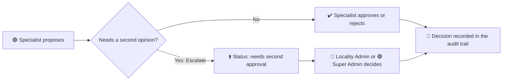

# 🔐 Civic Pulse: Roles & Permissions Spec

> 📚 Part of the [documentation index](README.md).

> **Status:** ✅ Approved by the owner (2026-10-17). This file is the **single source of truth**: change it first, then the code, then the tests.
> 🟩 The **database is aligned** with this spec (2026-10-17, permission test 26/26). Screens for managing users, the team and escalation are still to build (section 9).

## ⚡ In 30 seconds
- 🟣 **Super Admin**: runs the whole city and the system.
- 🔵 **Locality (Zone) Admin**: manages incidents and coordinates the team in their zone.
- 🟢 **Specialist Operator**: investigates one kind of incident (traffic, environmental or infrastructure) in their zone, and escalates when needed.
- 🔒 Everyone starts with **no access**. Rules are enforced in the **database**, not by hiding buttons.

## 🗝️ Legend
| Symbol | Meaning | | Symbol | Meaning |
|---|---|---|---|---|
| 🟣 | Super Admin | | ✅ | Allowed |
| 🔵 | Locality (Zone) Admin | | ❌ | Not allowed |
| 🟢 | Specialist Operator | | 🔶 | Allowed, but only inside the user's scope |
| 🚦 | Traffic | | 🟩 | Active / working |
| 🌿 | Environmental | | 🟨 | Partly done |
| 🏗️ | Infrastructure | | 🟥 | Gap or problem to fix |
| ⚪ | Created but empty / inactive | | ⬜ | To do |

---

## 🎯 1. Principles
1. 🔒 **Least privilege.** A new user has no role and sees nothing until a Super Admin assigns one.
2. 🛡️ **Enforced in the database**, never only in the screen. The UI may hide things for clarity; the database must still refuse.
3. 🧭 **Four things decide what a user can do:** their **role**, their **localities**, their **incident categories**, and the **actions** allowed (section 4).
4. 🤖 **The AI agent has no extra power.** It works as the signed-in user, so it can never show what that user could not see.
5. 📜 **Everything important is recorded** in an audit trail that users cannot forge.

---

## 👥 2. Roles (3 active)
| | Role | Where they work | What they are for |
|---|---|---|---|
| 🟣 | **Super Admin** | Whole city, all categories | Full access across the city. Manages users, roles and system settings. |
| 🔵 | **Locality (Zone) Admin** | Their localities, **every category** inside them | Manages incidents and coordinates their team within their zone. |
| 🟢 | **Specialist Operator** | Their localities, **only the categories the Super Admin gives them** | Investigates incidents in their categories and escalates when needed. |

> 🗑️ **Removed on 2026-10-17:** General Operator and Sector Admin. If sector-level access is ever needed, it comes back as a new *geographic scope*, not as a role.

### 🧩 Specialist Operator and specializations
A **specialization** is a *group of incident categories*. The Super Admin picks the **categories for each person**; the specialization is just the label that follows. All specialists have **identical permissions**: they differ only in categories.

| | Specialization | Incident categories under it | Status |
|---|---|---|---|
| 🚦 | **Traffic** | Obstructive parking | 🟩 Active, has data |
| 🌿 | **Environmental** | Illegal dumping | 🟩 Active, has data (150 synthetic incidents) |
| 🏗️ | **Infrastructure** | *(none yet)* | ⚪ Created, empty. Categories added later |

---

## 🗺️ 3. Scope (where and what a user can see)
- 📍 **Geography:** the 20 official Bogotá localities. 🟣 sees all; 🔵 and 🟢 only their assigned localities.
- 🏷️ **Categories:** 🟣 all. 🔵 all categories inside their localities. 🟢 only the categories assigned to them.
- 🚫 A specialist with **no categories** sees **nothing** (least privilege).
- 🗺️ The map may show Bogotá as background, but never restricted records.

---

## 🔐 4. Permission matrix
✅ allowed · ❌ not allowed · 🔶 allowed inside the user's scope

| Action | 🟣 Super Admin | 🔵 Locality (Zone) Admin | 🟢 Specialist Operator |
|---|---|---|---|
| 👁️ View incidents | ✅ all | 🔶 their localities, all categories | 🔶 their localities and categories |
| 📷 View evidence (photos, videos) | ✅ all | 🔶 in scope | 🔶 in scope |
| 💬 Ask the AI agent | ✅ all data | 🔶 in scope only | 🔶 in scope only |
| 📝 Propose a recommendation | ✅ | ✅ | ✅ |
| ✔️ Approve / reject a recommendation | ✅ | ✅ | 🔶 their categories and localities |
| ⬆️ Escalate for a second approval | n/a | n/a (they are the ones who receive it) | ✅ their choice |
| 🧑‍⚖️ Review escalated recommendations | ✅ | ✅ | ❌ |
| 📌 Assign incidents to a team member | ✅ | 🔶 within their zone | ❌ |
| 👨‍👩‍👧 View their team | ✅ all | 🔶 their zone | ❌ |
| 📜 View audit trail | ✅ all users | 🔶 own actions | 🔶 own actions |
| 🧑‍💼 Manage users, roles, localities and categories per person | ✅ | ❌ | ❌ |
| ⚙️ Manage system settings (specializations, categories, which localities exist) | ✅ | ❌ | ❌ |

### ⬆️ Escalation rule

- 🧠 Escalation is the **specialist's choice** for now.
- 🔮 **In the future** the AI agent will *advise*: "I recommend you escalate instead of approving", for example when several reports in the same area should be grouped into one big intervention.
- 🔒 Once escalated, a **specialist can no longer decide** it. Only 🔵 or 🟣.
- 🖥️ No screens are specified here. They come later, with the agent.

---

## 🚪 5. How users get access (provisioning)
1. 🆕 Anyone can register. They get **no role** and see an "Access pending" screen.
2. 🟣 **Only a Super Admin** assigns role, localities and categories, on the **Users** screen (header button). Nobody can change their own role or status there.
   - ✅ New sign-ups appear first as **Pending**; changes save immediately and are written to the audit trail.
   - 🛟 The database refuses to demote or switch off the **last active Super Admin**.
   - 📨 **Create user** (same screen): the Super Admin enters name and email, picks **one role** (Super Admin, Locality (Zone) Admin or Specialist Operator), the **zone(s)** for the last two (a dropdown with a checkbox per locality), and for a Specialist the **categories**, as checkboxes grouped by specialty (the specialty is shown from the categories ticked). The person gets an invitation email and chooses their own password; role and access are already assigned when they arrive.
   - 🔑 Done by a server function (Edge Function `invite-user`), the only place the admin key lives ([decision 0011](decisions/0011-invite-users-by-edge-function.md)). It checks the caller, validates, sends the invite, assigns access, audits, and removes the new account if any step fails.
   - 🔐 The invitation link works **once**. The password step follows the **account**: an invited person without a password is asked to "Set up your account" (name and email shown read-only) on every visit until it is set. If they lose the link, **Forgot password?** on the sign-in page emails a new one.
   - ⏳ An invited person shows as **Pending** (tag "Invited") until they accept the invitation, then **Active**. A flag on their profile is set by the function and cleared by a database trigger when they confirm the email link.
   - 🧮 Rule: **you can only grant access you have**. Today only a Super Admin invites, and a Super Admin has everything, so nothing is limited; the function enforces the rule for when restricted admins exist.
3. 🥇 The **first Super Admin** is set once by SQL in the Supabase SQL editor (README, section "Auth and roles"), never from the app.
4. 🚀 Before going live: "Confirm email" on and leaked-password protection on ([deploy.md](deploy.md)).

---

## 🛡️ 6. Rules that must always hold
1. 🚫 Nobody can give themselves a role, activation, or a wider scope.
2. 🔍 Nobody receives records outside their localities and categories: not through the screen, the API or the AI agent.
3. 📝 A recommendation starts as *proposed*. Its status changes only through a recorded decision or escalation.
4. 🧾 Decisions are append-only. Audit events are written only by the database and cannot be forged.
5. ⚙️ Only a Super Admin changes system settings and access.
6. 🔒 A recommendation waiting for a second approval cannot be decided by a Specialist.

---

## 🧪 7. Test cases (they map to `supabase/tests/rls_smoke.sql`)
| # | Case | Expected | Covered today |
|---|---|---|---|
| T1 | 🔵 reads incidents | only their localities, all categories | ✅ |
| T2 | 🟢 reads incidents | only assigned localities and categories | ✅ |
| T3 | 🟢 with no categories | sees nothing | ✅ |
| T4 | Anyone but 🟣 changes their own role | blocked | ✅ |
| T5 | 🟢 proposes outside their scope | blocked | ✅ |
| T6 | 🟢 approves inside their scope | allowed | ✅ |
| T7 | 🟢 decides an escalated recommendation | blocked | ✅ |
| T8 | 🔵 decides an escalated recommendation | allowed | ✅ |
| T9 | 🔵 creates or changes a user | blocked | ✅ |
| T10 | 🔵 reads another locality | blocked | ✅ |
| T11 | Agent tools run as a restricted user | scoped like T1 or T2 | ✅ |
| T12 | Anyone inserts an audit event or a pre-approved recommendation | blocked | ✅ |

---

All 12 cases are covered by 26 checks, all passing (2026-10-17).

---

## ❓ 8. Open questions
1. 🔶 Should escalation ever be **mandatory** (for example for grouped incidents)? *Today: advisory, agent-suggested later.*
2. 🔶 May a 🔵 approve a recommendation **they proposed themselves**? *Suggestion: yes for the MVP, always audited.*
3. 🔶 What does "view their team" show: name and specialty only, or also open work? *Suggestion: name, specialties, number of open assigned incidents.*
4. 🔶 If a specialist belongs to several localities, can the 🔵 of just one of them see them? *Suggestion: yes, inside the shared locality.*

---

## 🧱 9. As built today (2026-10-17)
| | Item |
|---|---|
| 🟩 | **3 roles** in the database. Permissions are **data** (`role_permissions`) read by every access rule and by the app (`can(action)`): no more duplicated role lists. |
| 🟩 | Scope by **locality and category**: Locality Admin sees all categories in their localities; Specialist only assigned categories; none assigned means nothing. |
| 🟩 | Recommendations and decisions scoped by locality **and category**. |
| 🟩 | **Escalation:** status `needs_second_approval`; a specialist's escalation is the database function `escalate_recommendation`; once escalated only Locality Admin or Super Admin can decide. |
| 🟩 | Specializations and categories tables (traffic: parking, environmental: illegal dumping, infrastructure: empty). 150 synthetic dumping incidents. |
| 🟩 | Agent tools need the `ask_agent` permission and take an optional category. |
| 🟩 | Permission test: 35 checks (T1 to T13 plus extras), all passing. |
| 🟩 | **Users screen** (Super Admin): table, search and filters, side panel for role, active switch, localities and categories. Last-Super-Admin guard and audit trail in the database. |
| 🟩 | **Create user:** invitation by email with role, zones and categories; set-password screen for the invited person. |
| 🟩 | **Forgot password?** on the sign-in page. |
| 🟥 | No resend invite, admin-triggered password reset or delete user yet. |
| 🟥 | Restricted Super Admins, and Zone Admins inviting specialists into their own zone (would change this spec). |
| 🟨 | A specialist's **specialty is derived from their categories**. Infrastructure has no categories yet, so it cannot be chosen until we add some. |
| 🟥 | **No team view and no incident assignment screen** (`incidents.assigned_to` exists; database lets Locality Admin and Super Admin assign). |
| 🟥 | **No escalate button.** The database function works; screens come with the agent. |
| 🟥 | No sample user per role to sign in with (the test uses rolled-back fake users). |
| 🟨 | Incident status changes have no screen; only Super Admin and Locality Admin may update incidents. |

---

## 🛠️ 10. What is left to build (separate approval)
- 🖥️ Super Admin screen (users, roles, localities, categories) and settings.
- 👨‍👩‍👧 Locality Admin team view and incident assignment.
- ⬆️ Escalate button and second-approval queue, with the agent's advice to escalate.
- 👤 One sample user per role for manual sign-in tests.

---

## 📜 11. Decision log
| Date | Decision | Why |
|---|---|---|
| 2026-10-17 | Roles reduced to 🟣 Super Admin, 🔵 Locality (Zone) Admin, 🟢 Specialist Operator | Simpler, matches the real organization |
| 2026-10-17 | Specialists differ only by categories, assigned per person by the Super Admin | Same duties, different incident types |
| 2026-10-17 | 🚦 Parking under Traffic; 🌿 illegal dumping under Environmental; 🏗️ Infrastructure created empty | Owner's category model |
| 2026-10-17 | 🔵 sees all categories in their localities | Brief: investigate incidents within authorized localities |
| 2026-10-17 | Specialists approve within scope and can escalate for a second approval | Owner's escalation model (replaces the earlier "only admins approve") |
| 2026-10-17 | Only 🟣 manages users and system settings | Least privilege |
| 2026-10-17 | No other roles for now | Owner's decision |
| 2026-10-17 | Spec restyled with emojis, legend and diagram for readability | Owner's request |
| 2026-10-17 | Permissions stored as data (`role_permissions`) and checked by `has_permission()` | One source for database and app; see [decision 0007](decisions/0007-permissions-as-data.md) |
| 2026-10-17 | Categories and specializations became tables | Extensible without code changes; see [decision 0008](decisions/0008-categories-and-specializations-tables.md) |
| 2026-10-17 | Illegal dumping is active with 150 synthetic incidents; the agent is category-aware | Owner's decision, so the second category is visible and testable |
| 2026-10-17 | Database aligned with this spec; permission test 26/26 | Implementation step 1 |
| 2026-10-18 | Recommendations screens removed for now; the database rules stay | Owner: not needed yet. See [decision 0009](decisions/0009-recommendations-screens-removed.md) |
